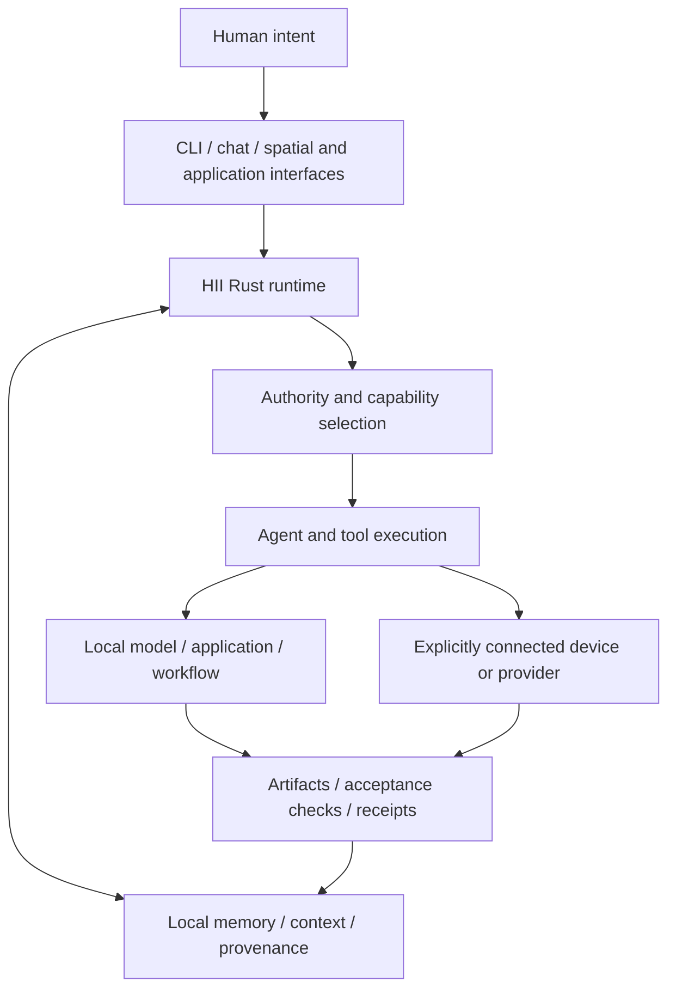

# HII — Human Information Interface

### Turn the context you own into work you can verify.

HII connects your information, models, agents, tools, and devices around what you want to accomplish. It is a local-first environment for keeping context, executing work, and preserving results, built around a Rust command-line runtime with chat, spatial, browser, and application interfaces around it.

**Your information stays useful between sessions. Your models remain replaceable. Your tools work inside an environment you control.**

[Start with the CLI](#start-with-the-cli) · [What exists today](#what-exists-today) · [The capability network](#the-capability-network) · [Architecture](#architecture) · [Contribute](CONTRIBUTING.md)

> **Project stage:** active development. This repository contains working components and experimental integrations with different levels of readiness. The Rust CLI is the clearest entry point. A public capability marketplace, provider earnings, and production settlement are not launched by this code. Use execution components on trusted machines while security hardening and release validation continue.

## The problem

A project can span a folder of files, a chat, a browser, several applications, and more than one computer. The information is there, but the connections are fragile. Each new session starts by rebuilding context. Each tool brings its own interface. Each result needs to be checked and connected back to the work.

HII brings those parts into one continuing environment:

**Intent → Context → Authorization → Execution → Verification → Receipt → Memory**

The goal is to make the distance between wanting something and making it happen smaller, while keeping the work understandable and under the person's control.

## What you can do with HII

| Need | HII's approach | Source |
| --- | --- | --- |
| Continue a project without repeating its history | Capture and search local file memory; compile bounded, source-linked context | [Memory](cli/src/memory.rs), [context packs](crates/hii-core/src/context_pack.rs) |
| Work with your own models | Select named inference backends and keep their model configurations separate | [Backend routing](cli/src/backends.rs) |
| Give an agent a concrete task | Run a workspace goal with tools, time/step limits, acceptance checks, and a durable receipt | [Agent runtime](cli/src/agent.rs), [completion assessment](cli/src/completion.rs) |
| Connect agents to useful tools | Discover native capabilities and operator-configured MCP servers | [Capability resolution](cli/src/capability_resolver.rs), [MCP](cli/src/mcp.rs) |
| Use another enrolled computer | Dispatch explicit CLI and agent requests over SSH | [Peer dispatch](cli/src/remote_cli.rs) |
| Share inference across trusted machines | Queue independent, bounded text jobs for matching contributor runtimes | [HII Compute](crates/hii-compute/README.md) |
| Connect information to design work | Explore Rhino, Grasshopper, spatial objects, and application adapters | [Integrations](integrations), [workspace primitives](lib/workspace) |

These are source-backed capabilities, not a claim that every integration is installed, configured, or verified on your device.

## A concrete interaction

You are working on a building model. Relevant drawings, notes, references, and decisions are scattered across tools and earlier conversations. The HII experience we are building is:

1. Bring the relevant sources into the project's context.
2. State the outcome: inspect a model, prepare a document, generate an image, or carry out a bounded design operation.
3. Select a model and an available capability under explicit permissions.
4. See the work and its failures as they happen.
5. Check the result against declared requirements.
6. Keep the artifact, its sources, and the receipt so the next session can continue.

Rhino is one proving ground because its results can be inspected in a real, editable professional application. The same interaction can apply to software, research, documents, and image workflows. The complete cross-provider commercial version remains a development milestone.

## Why HII

- **Continuity:** context, artifacts, and run history belong to the environment rather than disappearing with a model session.
- **Choice:** models and explicitly configured providers can change without replacing the user's information environment.
- **Control:** local storage and execution are the foundation; hosted integrations have separate configuration and trust boundaries.
- **Evidence:** a successful process, a returned model response, and a verified outcome mean different things. HII records execution and completion evidence instead of treating every generated answer as proof.
- **Extensibility:** capabilities can be exposed to agents and human interfaces without requiring a new application for every task.

HII is useful first as a personal operating environment for builders, designers, researchers, and people developing agent workflows. Its longer-term reach is an open network of capabilities that other interfaces can use too.

## Architecture



The Rust runtime is the intended authority for local state, routing, execution, and receipts. Models supply reasoning and generation. Interfaces project the environment. Connectors adapt external systems. A model response or a UI action must not silently become a broader permission grant.

| Repository area | Responsibility |
| --- | --- |
| [`cli/`](cli) | Commands, agent/conversation loops, tools, routing, device operations, receipts |
| [`crates/hii-core/`](crates/hii-core) | Shared local memory, context, runtime objects, and run ledger |
| [`crates/hii-chat/`](crates/hii-chat) | Conversation persistence, providers, streaming, and recovery |
| [`crates/hii-compute/`](crates/hii-compute) | Trusted-contributor text inference queue and workers |
| [`native-runner/`](native-runner) | Native model runtime integration; hardware/toolchain requirements apply |
| [`runtime/`](runtime), [`lib/`](lib) | Agent adapters, model helpers, capability contracts, and interface support |
| [`fabric/`](fabric) | Device identity, relay, protocol, capture, and receiver foundations |
| [`workers/`](workers), [`personal-workspace/`](personal-workspace) | Hosted adapters and personal web workspace components |
| [`apps/`](apps), [`extensions/`](extensions), [`integrations/`](integrations), [`macos/`](macos) | Optional surfaces and application integrations |

The repository spans several experiments and generations of the product. Building the CLI does not deploy web services, configure a public site, or install every interface. Some components remain independently built and tested.

## What exists today

| Area | Present in this repository | Important boundary |
| --- | --- | --- |
| Local runtime | Rust CLI, agent/conversation execution, tools, receipts | Requires configured models and appropriate host permissions |
| Context and memory | File capture, versions, search, restore, context-pack compilation | Local memory is not automatic synchronization between independent owners |
| Inference | Named OpenAI-compatible and Ollama backends; native runtime integration | Models, GPU support, and completion quality depend on the actual backend |
| Capabilities | Catalog, discovery, resolution, skills, and MCP adapters | A ready registry entry is not proof of a completed task |
| Distributed compute | Authenticated coordinator, worker pull, model matching, expiring leases, saved results | Trusted contributors; text-only independent jobs; no pooled VRAM or split-model inference |
| Device fabric | Identity, scoped-grant, relay, and capture/receiver components | Foundation components do not establish a complete production transport or marketplace identity system |
| Human interfaces | Terminal/chat, web, spatial, browser, and macOS components | Availability and setup vary; no single installer deploys the whole platform |
| Commerce | Quote/job/ledger types and server-side billing helpers | A complete funded, auditable multi-provider settlement flow is not demonstrated |

## The capability network

HII's larger direction is a network where people contribute information, intelligence, compute, workflows, and services, and other people or agents discover and purchase useful outcomes.

**Discover → Quote → Authorize → Execute → Verify → Settle**

A GPU owner could provide inference. A workflow creator could publish an image-generation capability. A specialist agent could perform a research task. The customer would receive a result without having to assemble the underlying tools.

The proposed business model is a disclosed fee on completed capability transactions and optional managed services. Prices, provider revenue shares, credit redemption, payouts, and payment-provider arrangements remain to be validated. Local use of the Apache-licensed source does not require buying marketplace credits.

**The first commercial milestone:** one independent provider publishes a capability; a customer or agent approves a bounded price; the provider executes the job; the result is checked; costs, compensation, and a transaction receipt are recorded. An image workflow is a candidate first vertical.

Before opening participation more broadly, the network needs per-provider identity and revocation, customer isolation, enforceable spending permissions, idempotent job and financial transitions, acceptance/dispute rules, and measured reliability and unit economics. The existing compute queue does not supply those guarantees. Its worker receipts explicitly describe output as worker-reported.

Map, canvas, chat, and CLI are complementary ways into this environment. A map can connect capabilities to places and eventually physical services; the underlying contracts should remain usable without adopting HII's own interface.

## Start with the CLI

You need Git and a working Rust/Cargo toolchain. Optional helpers and interfaces also need Node.js and their platform-specific dependencies. Private repository access uses your existing authorized Git credentials or SSH setup.

```sh
git clone https://github.com/umminuriddingreen/hii.git
cd hii
cargo build --locked -p hii-cli
./target/debug/hii --help
```

On Windows, the binary is `.\target\debug\hii.exe`. The examples below use `hii` for that executable; use its full path or put it on your PATH.

Start a compatible inference server separately, then register its real endpoint and served model ID:

```sh
hii backend add local --url http://127.0.0.1:8080/v1 --default-model '<served-model-id>'
hii backend test local
hii backend use local
hii ask 'Hello'
```

For native Ollama protocol, use `--protocol ollama` with its actual endpoint. `backend test` checks the model catalog; a successful `ask` verifies a completion. Selection does not start a server, download weights, or delete models. An unavailable selection reports an error rather than silently switching engines.

Capture local context and try a direct model question from a project directory:

```sh
hii memory save ./notes.md
hii memory search 'project constraints'
hii ask 'Summarize the constraints in the context I provide'
```

For trusted local work that needs arbitrary programs, explicitly choose owner authority and declare how the result should be checked:

```sh
hii --max-steps 12 --deadline 120s run 'Fix the failing unit test' --authority owner --verify 'cargo test'
```

Tool execution runs with the account's host permissions. Authority labels and receipts must not be treated as an independently verified sandbox. The current release is intended for trusted local use, not untrusted providers. Review [SECURITY.md](SECURITY.md) before connecting tools or exposing services. See [HII Compute](crates/hii-compute/README.md) for trusted multi-machine inference setup and its current limits.

## Data, credentials, and updates

HII normally stores runtime data under `~/.hii`. `HII_RUNTIME_DIR` selects a different runtime directory; `HII_HOME` applies only to commands that support it.

Model credentials can use `HII_MODEL_API_KEY` or `HII_MODEL_API_KEY_FILE`. Named backend configurations support header references such as `env:VARIABLE_NAME` and `file:/absolute/path`. Keep secrets out of the repository, command history, screenshots, and public issue reports. Explicit environment overrides take precedence over selected backends.

Source updates, installed releases, and running services are separate concerns. Update scripts provide clean-checkout checks, recovery anchors, release markers, and verification paths. Device rollout must preserve local changes, model storage, and a known working release. Source code alone does not prove that a device has received or activated an update.

## Build with us

The next work is about completing and proving the loop: stronger execution boundaries, dependable device updates, one complete capability transaction, and interfaces that make the environment understandable.

Useful contributions include reproducible bugs, focused security fixes, provider/tool adapters, tests for failure and recovery paths, and carefully scoped design or workflow integrations. Start with [CONTRIBUTING.md](CONTRIBUTING.md). Report sensitive issues through [SECURITY.md](SECURITY.md), without public credentials or private data.

Run the owning component's checks, for example:

```sh
cargo test --locked -p hii-cli
cargo test --locked -p hii-compute
npm ci --ignore-scripts
npm test
npm run check
```

Hardware inference and platform-specific integrations need their own live acceptance checks. A green unit test suite is not a claim that all components are deployed or that distributed inference is economically competitive.

## License

First-party HII source is licensed under [Apache 2.0](LICENSE); see [NOTICE](NOTICE) and [third-party notices](third_party) for attribution and component terms. Model weights and external services have their own licenses and conditions. HII and Human Information Interface trademarks are not granted by the software license; see [TRADEMARK.md](TRADEMARK.md).

